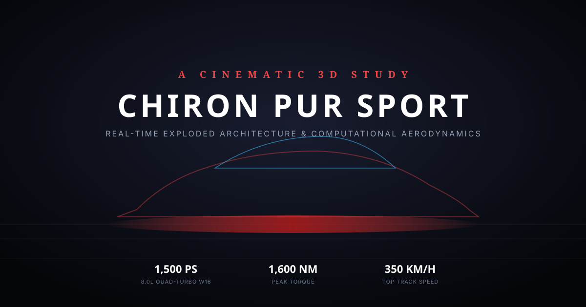

# Bugatti Chiron Pur Sport — A Cinematic 3D Study



> An immersive, scroll-driven real-time 3D web experience built with Three.js, GSAP ScrollTrigger, and Lenis. Explore the pinnacle of automotive hyper-engineering through cinematic camera moves, procedural PBR shaders, data-driven exploded architecture, and interactive telemetry.

🔗 **[Live Demo →](https://cinematic-3d-car.demo/)**

---

## ✨ Features

- **PCHIP Hermite Camera Spline** — 7 smoothly scrubbed cinematic chapters driven by Fritsch-Carlson monotone cubic splines with hydraulic inertia damping (zero jerk, zero overshoot).
- **Interactive 3D Hotspots** — Click and hover car parts (Quad-LED optics, W16 powertrain, carbon-ceramic brakes, aero wing, Alcantara cockpit) for glassmorphic specification popovers.
- **Drag-to-Orbit Exploration** — Free orbit within constrained azimuthal angles during the exterior chapter, smoothly returning control to the scroll spline, with full 360° unconstrained orbit at the showroom configurator.
- **Extended Luxury Customizer** —
  - **Paint Presets:** Deep Rosso, French Racing Blue, Stealth Noir, Liquid Silver, Iridescent Pearl
  - **Surface Finishes:** Ultra Gloss, Satin Frosted, Stealth Matte
  - **Aero Wheels:** Forged Magnesium, Stealth Noir, Hyper Silver, Tuscan Bronze
  - **Brake Calipers:** French Racing Red, Vibrant Speed Yellow, Acid Green, Stealth Noir
  - **Cabin Trim:** Pur Sport Alcantara, Beluga Noir Nappa, Cognac Saddle Leather
- **Shareable Configurations** — Customizer selections persist in the URL hash (e.g. `#paint=deep_rosso&finish=gloss&wheels=magnesium&calipers=racing_red&interior=pur_sport_alcantara`) and `localStorage` with a 1-click clipboard share button.
- **Exploded View Architecture** — 6 functional vehicle subsystems (body panels, optical arrays, cockpit, mechanical subframe, brakes, wheels) separate along 3D vectors with smooth S-curve easing, SVG leader lines, X-Ray chassis inspection, and a "Reset Exploded View" control.
- **Web Audio Soundscape** — Subtle procedural analog drone sound bed + cinematic transition whoosh SFX with a mute toggle button (muted by default).
- **Visual Effects & Cinematics** — Half-resolution Bloom, dynamic Depth of Field on macro close-ups, high-velocity speed lines, paint light sweep, and handheld camera micro-motion sway.
- **Mobile Optimized** — Lenis `syncTouch` touch scrolling, reduced exploded view jitter and simplified leader lines on small screens, and automatic default to performance Tier 1.
- **Clean Memory Management** — Deep traversal disposal for geometries, materials, textures, render targets, and event listeners on teardown and page unload.
- **Automated Validation & Unit Tests** — JSON schema validation via Ajv, naming consistency audit, and 23 unit tests verifying pure mathematical logic.

---

## 🛠 Tech Stack

| Layer | Technology | Details |
|---|---|---|
| **3D Engine** | [Three.js](https://threejs.org/) v0.170 | WebGL 2.0 PBR Shaders, ACES Filmic Tone Mapping, PMREM Studiocyclorama |
| **Animation** | [GSAP](https://greensock.com/gsap/) + ScrollTrigger | Scrubbed master timeline, hydraulic crane damping |
| **Smooth Scroll** | [Lenis](https://github.com/darkroomengineering/lenis) | Fluid scroll interpolation with `syncTouch` mobile support |
| **Post-Processing** | [postprocessing](https://github.com/pmndrs/postprocessing) | Half-res Bloom, Dynamic Bokeh Depth of Field, Chromatic Aberration, Vignette |
| **Sound Engine** | Web Audio API | Procedural drone synthesizer & transition whoosh SFX |
| **Compression** | Draco 3D / Basis KTX2 | Draco geometry compression (2.69 MB model) |
| **Testing** | Node Test Runner / Vitest | 23 unit tests for spline math, chapter progress, and exploded vectors |
| **Validation** | Ajv (Draft-07 Schemas) | Build-time validation of `explode.json` and `groups.json` |

---

## 🚀 Getting Started

### Prerequisites

- Node.js ≥ 18
- npm ≥ 9

### Install & Run

```bash
# Install dependencies
npm install

# Start local development server
npm run dev
```

Visit `http://localhost:5173` to explore the experience.

### Build for Production

```bash
# Build production bundle
npm run build

# Preview production build locally
npm run preview
```

### Testing & Validation

```bash
# Run unit tests (23 tests: spline interpolation, progress mapping, vector math)
npm test

# Validate config/explode.json and config/groups.json against JSON Schemas
npm run validate

# Audit node names and mapping consistency
npm run validate:names
```

---

## 📁 Project Structure

```
├── index.html                  # Main cinematic experience & semantic crawler fallback
├── package.json                # Project scripts, dependencies, devDependencies
├── PRD.md                      # Product Requirements & architectural design document
├── README.md                   # Project documentation & attribution
├── vite.config.js              # Vite bundler configuration (multiple entry points)
├── config/
│   ├── explode.json            # Subsystem explosion vectors, distances, and timeline ranges
│   ├── groups.json             # 388 mesh node name mappings to functional vehicle groups
│   └── parts.json              # Extracted mesh metadata (triangles, dimensions, centers)
├── public/
│   ├── config/                 # Static copies served at /config/
│   ├── draco/                  # Draco WASM decoders
│   ├── models/veyron.glb       # Optimized, Draco-compressed 3D vehicle model (2.69 MB)
│   ├── favicon.svg             # Vector favicon
│   └── og-preview.svg          # Social sharing open graph preview image
├── schemas/
│   ├── explode.schema.json     # JSON Schema for explode.json
│   └── groups.schema.json      # JSON Schema for groups.json
├── scripts/
│   ├── validate-json.js        # Ajv validation script
│   ├── validate-names.js       # Consistency auditor
│   ├── convert-ktx2.sh         # Batch texture conversion script for KTX2 (Basis Universal)
│   ├── dump-parts.mjs          # GLTF mesh hierarchy extractor
│   └── optimize.mjs            # GLTF-Transform optimization pipeline
├── src/
│   ├── main.js                 # App orchestrator, render loop, visibility pauses, teardown
│   ├── scene.js                # Three.js scene, PMREM softbox studio, floor reflector, lighting rig
│   ├── loader.js               # GLTFLoader, DracoLoader, scale normalization, procedural engine
│   ├── materials.js            # Automotive PBR materials, customizer logic, URL hash syncing
│   ├── explode.js              # ExplodeController with S-curve easing and mobile jitter scaling
│   ├── timeline.js             # PCHIP spline trajectory, orbit controls, speed lines, audio triggers
│   ├── overlay.js              # HTML overlays, customizer UI, specs modal, leader line tracking
│   ├── post.js                 # pmndrs postprocessing chain (half-res bloom, DoF, adaptive quality)
│   ├── audio.js                # Web Audio API synthesizer (ambient drone, whoosh, click, mute toggle)
│   ├── hotspots.js             # Interactive 3D raycasting hotspots with spec popover cards
│   ├── math-utils.js           # Pure math functions for PCHIP interpolation & progress mapping
│   ├── dispose.js              # Memory cleanup & resource disposal utilities
│   ├── content.js              # Copy, vehicle specifications, color presets, and legal disclosures
│   └── style.css               # Luxury automotive design system styling
├── tests/
│   ├── progress.test.js        # Unit tests for chapter resolution & PCHIP spline interpolation
│   └── explode.test.js         # Unit tests for explode vector arithmetic & config integrity
└── tools/
    └── inspector.html          # Interactive 3D model parts inspector & classification tool
```

---

## 🎨 Cinematic Chapters

| # | Chapter | Progress | Camera Angle | Visual & Interactive Features |
|---|---|---|---|---|
| **01** | **Hero Reveal** | `0.00 – 0.10` | Low 3/4 front angle | Moving rim light sweep across paint, headlight beam ignition, spring settle |
| **02** | **Exterior Orbit** | `0.10 – 0.28` | Side tracking arc | Full studio illumination, interactive drag-to-orbit with limit clamps, 3D hotspots |
| **03** | **Exploded View** | `0.28 – 0.68` | Elevated crane angle | 6 subsystems separate sequentially, leader lines, X-Ray mode, Reset Explode button |
| **04** | **Reassembly** | `0.68 – 0.78` | Pullback crane move | Smooth reverse reassembly restoring solid mechanical integrity |
| **05** | **Macro Detail** | `0.78 – 0.92` | Macro lens close-up | Quad-LED matrix optics, dynamic Depth of Field bokeh blur, continuous tail blade |
| **06** | **Showroom Config** | `0.92 – 1.00` | 360° Showroom view | Unconstrained 360° orbit, customizer dock (paint, finish, wheels, calipers, interior), share URL |

---

## ⚖️ Design Study Note & Model License Resolution

### Naming Mismatch Resolution
The 3D base geometry in `public/models/veyron.glb` originates from a high-poly Bugatti Veyron mesh (cleaned, optimized, and decimated to ~660,000 triangles). The visual presentation, procedural aerodynamic components (horseshoe front intake, lower carbon splitter, fixed 1.90m rear wing, quad-matrix LED projectors, and procedural mid-engine W16 internals) represent an artistic, non-commercial portfolio study of the **Bugatti Chiron Pur Sport** hyper-engineering philosophy. All copy and specifications in `src/content.js` are clearly documented as fan-made illustrative portfolio data.

### 3D Asset License & Attribution
- **3D Vehicle Model:** Sourced under standard non-commercial editorial license from CGTrader. Retained strictly for non-commercial educational and portfolio demonstrations.
- **Brand Emblems:** All vehicle names, trademarks, logos, and emblems belong to Bugatti Automobiles S.A.S. and Volkswagen AG. Not affiliated with, endorsed by, or sponsored by any automobile manufacturer. A configuration toggle (`CONFIG.SHOW_LOGOS = false` in `src/content.js`) is provided to render the model unbranded.

### Code License
The source code of this project is licensed under the **MIT License**.
